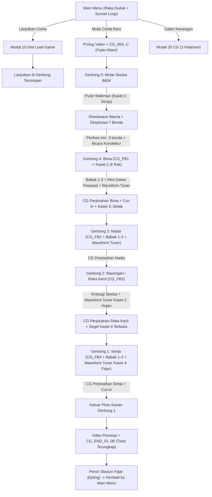

# Product Requirements Document (PRD)
## Gerbong Terakhir ke Stasiun Senja (*Track 99: Resonance*)

---

## I. Metadata Proyek & Ringkasan Eksekutif

| Atribut Proyek | Keterangan |
| :--- | :--- |
| **Nama Produk** | **Gerbong Terakhir ke Stasiun Senja** (*Track 99: Resonance*) |
| **Genre** | *2D Side-Scrolling Narrative Puzzle & Emotional Memory Adventure* |
| **Platform Target** | Desktop PC — Windows 10/11 (Python `3.10+`, dikembangkan & diuji pada **Python `3.12`**) |
| **Target Pembaca Dokumen** | Tim Mahasiswa Pengembang, Dosen Pembimbing, & Dosen Penguji |
| **Target Durasi Permainan** | **45 Menit** (*Single Playthrough* — *Slow-Paced Narrative*) |
| **Skala & Mode Dokumen** | Proyek Tim Mahasiswa (MVP Akademik Terkunci / *Locked*) |
| **Status Implementasi** | **MVP Selesai & Terverifikasi** (74 aset aktif, `--self-test` & audit aset lolos 100%) |

### Elevator Pitch
**Gerbong Terakhir ke Stasiun Senja** adalah game naratif 2D *side-scrolling* berbahasa Indonesia tentang **Raka Adiwangsa (24)**, seorang desainer yang mengalami kelelahan kreatif (*burnout*) dan terbangun di dalam gerbong kereta tanpa warna pukul **23:59**. Dengan memutar Walkman perak peninggalan kakeknya, pemain menyelaraskan emosi dan membantu para penumpang di sepanjang Gerbong 5 hingga Gerbong 1—hingga sebuah *plot twist* berlapis mengungkap bahwa perjalanan kereta ini sesungguhnya adalah ruang penerimaan diri terakhir sebelum Raka benar-benar "pulang".

### Visi Produk (*"First-Minute WOW"*)
Memberikan pengalaman emosional langsung pada satu menit pertama: pemain memulai di dunia sketsa hitam-putih yang bisu dan dingin, lalu saat menekan tombol **PLAY** pada Walkman Kaset 1 (*SENJA*), gelombang warna jingga senja meledak menyapu layar secara *real-time*, musik lofi mengalun, dan jendela kereta memutar pemandangan laut senja yang hidup.

---

## II. Latar Belakang & Problem Statement

### 2.1 Masalah dari Sisi Tema & Audiens (Mahasiswa / Dewasa Muda)
1. ***Creative Burnout* & Penyangkalan Diri:** Banyak mahasiswa dan pekerja kreatif muda mengalami tekanan ekspektasi, takut gagal setelah mendapat penolakan/kritik, lalu menumpuk kata *"nanti ya"* hingga kehilangan jati diri dan hubungan bermakna dengan orang terdekat.
2. **Kurangnya Game Naratif Lokal dengan Topik Memaafkan Diri Sendiri:** Kebanyakan proyek game mahasiswa berfokus pada mekanik aksi atau skor *arcade* semata, sehingga jarang mengeksplorasi kedalaman narasi reflektif berbahasa Indonesia yang natural, hangat, dan relevan secara psikologis.

### 2.2 Masalah dari Sisi Pengembangan Proyek Mahasiswa
1. **Risiko *Scope Creep*:** Proyek game mahasiswa sering gagal selesai tepat waktu karena lingkup terlalu luas (misalnya merancang *open-world* atau puluhan level pertarungan kompleks).
2. **Keterbatasan Jam Kerja & Konsistensi Aset:** Tim mahasiswa harus membagi waktu dengan perkuliahan lain sambil menjaga kualitas visual, audio, cerita, dan kode agar tetap rapi dan bebas *bug* saat demo di hadapan dosen.

### 2.3 Solusi yang Ditawarkan
Merancang game **terbatas ruang, kaya kedalaman (*narrow space, deep narrative*)**:
- Latar difokuskan hanya pada **5 Gerbong Kereta + 1 Peron Stasiun Fajar** sehingga seluruh energi desain dicurahkan ke detail objek memori, dialog bercabang yang natural, ilustrasi *CG Cutscene* bergaya *Wuthering Waves*, dan antarmuka ramping bergaya *Persona*.
- Memanfaatkan mekanik **Walkman 4 Kaset** sebagai pengubah suasana visual-audio sekaligus kunci teka-teki *Waveform Tuner* yang terintegrasi langsung dengan tema emosional cerita.

---

## III. Target Pengguna & Persona Inti

| Persona | Profil Singkat | *Jobs-to-be-Done (JTBD)* |
| :--- | :--- | :--- |
| **1. Mahasiswa / Pemain Game Naratif** | Usia 18–25 tahun, akrab dengan budaya internet/kampus, menyukai game cerita seperti *A Space for the Unbound*, *To the Moon*, atau gaya UI *Persona*. | Ingin merasakan cerita menyentuh berdurasi ~45 menit dengan alur natural, musik santai, teka-teki relaks (bukan uji refleks keras), dan *ending* berkesan. |
| **2. Dosen Pembimbing / Penguji Akademik** | Mengamati dari sisi rekayasa perangkat lunak, desain interaksi, orisinalitas cerita, dan kesiapan demo. | Ingin melihat bukti kesesuaian antara kebutuhan produk (PRD), arsitektur teknis (SRD), dokumentasi cerita, kelengkapan fitur *Save/Load*, dan aplikasi portabel yang langsung jalan tanpa instalasi rumit saat sidang/demo. |

---

## IV. Konsep Cerita, Karakter, & Struktur 5 Gerbong

### 4.1 Premis & *Dual-Layer Plot Twist*
Sepanjang permainan, Raka mengira ia hanya ketiduran di kereta komuter terakhir sepulang lembur pukul **23:59** dan terjebak dalam mimpi aneh di atas laut. Di penghujung cerita, terungkap dua lapisan kejutan (*dual-layer twist*):

| Lapisan | Dugaan Pemain Sepanjang Game | Kebenaran di Ending (Stasiun Fajar) |
| :--- | :--- | :--- |
| **Twist 1: Senja** | Dialog yang ambigu membuat pemain menduga sahabat Raka, **Senja Kirana**, sudah meninggal dunia dan Raka dibayangi rasa bersalah. | **Senja masih hidup.** Ia hanya pindah ke Yogyakarta naik kereta pagi 06:00 dan menerbitkan komik *TRACK 99* Vol. 1 menggunakan sketsa Raka. |
| **Twist 2: Raka & Kereta** | Pemain mengira kereta ini sekadar metafora psikologis atau mimpi karena kelelahan kerja. | **Raka dan seluruh penumpang di kereta telah meninggal dunia** (Raka tertidur kelelahan di kereta terakhir 23:59 dan tidak pernah bangun lagi). Kereta adalah ruang persinggahan jiwa hingga Raka mampu memaafkan dirinya sendiri. |

### 4.2 Profil Karakter Utama

| Karakter | Usia / Peran | Konflik & Simbolisme Batin |
| :--- | :--- | :--- |
| **Raka Adiwangsa** | 24 th / Protagonis (Desainer grafis agensi, mantan ilustrator komik *TRACK 99*) | Merobek buku sketsa di bawah hujan setelah ditolak penerbit dan dihujat komentar internet; selalu menghindari Senja dengan kata *"nanti"*. |
| **Pak Kondektur (Kakek Harjo)** | ~70 th / Pemandu Kereta (Mantan masinis *Senja Utama*) | Menolak melubangi tiket 23:59 Raka di awal karena jiwa Raka belum siap turun. Baru membuka topi kondektur dan identitas aslinya di peron akhir. |
| **Bima Sakti Pratama** | 9 th / Penumpang Gerbong 4 (Pasien *Ruang Anggrek 3*) | Merasa menjadi "beban" karena kakaknya (Mas Dimas) berhenti les gambar demi biaya rumah sakit; takut menerbangkan pesawat kertas terakhir. |
| **Nadia Larasati** | 26 th / Penumpang Gerbong 3 (Arsitek junior) | Membentak ibunya lewat telepon pukul **01:14** saat lembur di malam ulang tahun sang ibu sebelum mengalami kecelakaan fatal sepulang kerja. |
| **Bayangan Raka / Raka Kecil** | Manifestasi batin & diri Raka usia 8 th / Penumpang Gerbong 2 | Sosok tinta gelap yang menyuarakan kebencian diri Raka; luruh menjadi Raka Kecil berkrayon setelah lembaran sketsa disambung emas (*Kintsugi*). |
| **Senja Kirana** | 24 th / Sahabat & penulis *TRACK 99* (versi ingatan di Gerbong 1 & versi hidup di Ending) | Membuat *mixtape* 4 kaset untuk Walkman Raka; di Gerbong 1 menjadi cermin penerimaan bahwa Raka tidak perlu lagi terus menyalahkan diri. |

### 4.3 Peta Perjalanan 5 Gerbong + Stasiun Fajar

| Lokasi | Tahap Batin Raka | Kaset Utama | Benda Memori Kunci | Mekanik & Cutscene |
| :--- | :--- | :--- | :--- | :--- |
| **Gerbong 5 (Keheningan)** | Penyangkalan | `0: Keheningan` -> **`1: SENJA`** | 7 benda (Walkman, Tiket 23:59, Teh Melati, Jam Saku, Ponsel Retak 99+, Kaset D Tersegel, Papan Rute) | Video Prolog + `CG_00A–C`; **Shockwave Warna** saat memutar Walkman; Dialog Pak Kondektur. |
| **Gerbong 4 (Rak Buku & Langit Sore)** | "Aku cuma beban" | **`1: SENJA`** *(membuka `2: HUJAN` di rak buku)* | 5 benda (Kaset B, Komik Dimas, Gelang Pasien & Pesawat, Bekal Batik, Papan Kapur 99) | Kilas Balik `CG_FB1A–B`; Mini-game **Pesawat Kertas** + **Waveform Tuner** (2.3 Hz, 46 Amp); Perpisahan `CG_BIMA_A–B`; membuka **Kaset 3: DETAK**. |
| **Gerbong 3 (Meja Kerja & Jam 01:14)** | Kata yang tak sempat | **`3: DETAK`** | 5 benda (Ponsel 14 *missed calls*, Bekal Ibu, Maket Rumah Tepi Laut, Helm Retak, Jam Dinding 01:14) | Kilas Balik `CG_FB2A–B`; Dialog bercabang + **Waveform Tuner** (3.4 Hz, 64 Amp); Perpisahan `CG_NADIA_A–B`. |
| **Gerbong 2 (Cermin Hujan)** | Menerima diri sendiri | **`2: HUJAN`** *(dengan efek refleksi kaca tertinggal 0.28 dtk)* | 4 benda (4 Sobekan Sketsa, Payung & Surat Penolakan, Draf *TRACK 99*, Cermin Hujan) | Kilas Balik `CG_FB3A–B`; Mini-game **Kintsugi Sketsa** + **Waveform Tuner** (1.9 Hz, 34 Amp); Perpisahan `CG_BAYANGAN_A–B`; segel **Kaset 4: FAJAR** terbuka. |
| **Gerbong 1 (Ruang Masinis)** | Melepaskan | **`4: FAJAR`** | 5 benda (Naskah Bab Akhir, Polaroid Kampus, Topi Masinis, Kumpulan Tiket Bintang, Tuas Rem Kuningan) | Kilas Balik `CG_FB4A–B`; **Waveform Tuner** (4.1 Hz, 78 Amp); Perpisahan `CG_SENJA_A–B`. |
| **Peron Stasiun Fajar** | Pulang | `4: FAJAR` & Angin Pagi | Tiket 23:59 berlubang bintang | Video Penutup + `CG_END_01–06` (Pengungkapan Kakek Harjo & Senja hidup) + Layar Epilog Stasiun Fajar. |

---

## V. Ruang Lingkup Proyek (Scope Boundary — Realistis untuk Mahasiswa)

### 5.1 *In-Scope* (Wajib Hadir & Telah Terimplementasi)
1. **Eksplorasi Side-Scrolling 2D:** Gerak kiri-kanan (`A`/`D`, Panah, atau Klik Mouse), duduk santai di kursi kiri, interaksi benda memori (`[E]`/Klik), serta *auto-walk* ke posisi berdiri bebas tumpang-tindih saat berbicara dengan NPC.
2. **Sistem Walkman 4 Kaset:** HUD kapsul kanan atas yang dapat diperluas (`[TAB]`/Klik) untuk memutar **Senja**, **Hujan**, **Detak**, dan **Fajar**; setiap kaset mengubah video jendela kereta, palet warna ruangan, filter atmosfer, BGM, serta memunculkan bisikan batin (*Rain Whisper*) khusus pada kaset **Hujan**.
3. **25 *Illustrated CG Cutscene* + 5 Video MP4:** Cutscene statis penuh gaya *Wuthering Waves* dengan efek *Ken Burns zoom*, transisi tirai hitam (kilas balik) dan putih (perpisahan/ending), teks tipe-writer, tombol `LEWATI`, dan animasi partikel.
4. **3 Variasi Mini-Game Relaks:**
   - **Waveform Tuner** (menyamakan gelombang emosi frekuensi/amplitudo + efek riak tetesan air saat mengganti kaset + opsi `[TAB]` *Auto-Tune* untuk aksesibilitas).
   - **Terbangkan Pesawat Kertas Bima** (Gerbong 4: menangkap 5 cahaya kenangan).
   - **Kintsugi Sketsa** (Gerbong 2: menyambung 4 sobekan buku gambar dengan garis emas).
5. **Persistensi Lokal & Galeri:** *Pause Menu* (`ESC`), **10 Slot Save/Load** mandiri di dalam folder game, dan **Galeri Kenangan** (3 halaman × 9 kartu untuk 25 CG yang otomatis terbuka saat ditonton di cerita).
6. **Distribusi Portabel Mahasiswa:** Kemampuan dijalankan langsung via `.venv` atau dibungkus menjadi bundel `.exe` portabel (`PyInstaller --onedir`) beserta sistem verifikasi otomatis (`--self-test`) dan audit aset.

### 5.2 *Out-of-Scope* (Dibatasi Tegas agar Tidak Melebihi Kapasitas Mahasiswa)
1. **Tidak ada sistem pertarungan (*combat* / HP / *game over*):** Konflik diselesaikan melalui empati dialog dan penyelarasan *Waveform Tuner*.
2. **Tidak ada sulih suara penuh (*full voice acting*):** Digantikan desain audio BGM emosional dan 10 *sound effect* akustik (`text_blip`, `ticket_punch`, `chime`, `wind_petals`, dll.).
3. **Tidak ada *server online* / *cloud save* / *multiplayer*:** Seluruh data tersimpan 100% *offline* dan portabel di `userdata/saves/`.
4. **Tidak ada eksplorasi kota di luar kereta:** Latar luar diwakili oleh animasi video jendela kereta dan ilustrasi CG epilog Stasiun Fajar.

---

## VI. Alur Pengguna (*User Flow*) & Inventaris Layar

### 6.1 Diagram Alur Permainan Inti

### 6.2 Inventaris Layar (*Screen Inventory*)

| Nama Layar / Overlay | Tujuan Fungsional | Komponen UI Utama |
| :--- | :--- | :--- |
| **TitleScreenScene (Main Menu)** | Gerbang utama aplikasi dengan suasana senja langsung terasa. | Raka duduk di kursi kiri (`Raka_sit1..3`), video jendela laut senja, judul serif besar **GERBONG TERAKHIR — KE STASIUN SENJA**, 4 tombol *skewed* ala *Persona* (*Mulai Cerita Baru*, *Lanjutkan Cerita*, *Galeri Kenangan*, *Keluar*). |
| **Carriage Gameplay View** | Ruang eksplorasi *side-scrolling* tiap gerbong. | Video jendela bergerak di balik kaca *chroma-key*, layer gerbong sesuai kaset aktif, sprite 4-frame Raka & NPC, objek memori interaktif, indikator `[E / Klik]` melayang, tombol `ESC Menu` & kapsul `WalkmanHUD` di kanan atas. |
| **Dialogue & Choice Box** | Menyampaikan narasi mendalam tanpa menghalangi layar bawah secara berlebihan. | Kotak dialog ramping berpotret ekspresi (`calm`, `sad`, `smile`, `surprised`), teks *typewriter* terbungkus rapi per kata, serta panel pilihan dialog (*branching choice*). |
| **WutheringWavesCGOverlay** | Memutar adegan sinematik *flashback*, perpisahan, dan *ending*. | Gambar penuh 1280×720 dengan *Ken Burns zoom*, tirai fade hitam/putih, gradasi gelap bawah untuk keterbacaan subtitel, tombol kapsul `LEWATI` di kiri atas. |
| **WaveformTunerModal** | Teka-teki penyelarasan emosi penumpang di tiap gerbong cerita. | Panel osiloskop 2 gelombang sinus (target penumpang vs gelombang pemain), tombol pilih 4 kaset dengan animasi **riak tetesan air**, meter *Resonance*, dan tombol bantuan `[TAB] Auto-Tune`. |
| **Mini-Game Modals** | Memperkuat variasi interaksi mekanis sesuai cerita gerbong. | *Terbangkan Pesawat Kertas* (kontrol kursor/`W`/`S` menangkap 5 orb cahaya) & *Kintsugi Sketsa* (papan 2×2 menyambung 4 sobekan kertas dengan garis emas). |
| **Pause, Save/Load & Gallery Modals** | Manajemen progres dan apresiasi karya visual oleh pemain/penguji. | Menu jeda (`ESC`), kisi 2×5 slot simpan/muat berdurasi & jumlah tiket, serta Galeri 3×3 (3 halaman) dengan *shortcut preview* `F8` untuk dosen/penguji. |

---

## VII. Kebutuhan Fungsional & Aturan Bisnis (MoSCoW)

| ID | Prioritas | Fitur & *User Story* | *Acceptance Criteria* (Kondisi Sukses) |
| :--- | :--- | :--- | :--- |
| **`F-01`** | Must Have | **Menu Utama & Navigasi Awal:** Sebagai pemain, saya ingin disambut menu utama yang tenang dan jelas agar dapat memulai baru, melanjutkan simpanan, atau melihat galeri. | 1. Menampilkan 4 opsi (*Mulai Cerita Baru*, *Lanjutkan Cerita*, *Galeri Kenangan*, *Keluar*) tanpa label teknis mengganggu. 2. Mendukung navigasi keyboard (`W/S`/`Panah`/`Enter`/`Space`) dan klik mouse. |
| **`F-02`** | Must Have | **Efek WOW & Eksplorasi Gerbong 5:** Sebagai pemain, saya ingin merasakan perubahan dunia sketsa hitam-putih ke dunia berwarna saat menyalakan Walkman. | 1. Awal Gerbong 5 terkunci di mode sketsa (`cassette_id = 0`) hingga pemain menekan PLAY Walkman (`[SPACE]`/`[1]`/Klik). 2. Memicu gelombang kejut (*shockwave*) berwarna senja. 3. Pintu Gerbong 4 terbuka setelah memeriksa min. 3 dari 7 benda dan berbicara dengan Pak Kondektur. |
| **`F-03`** | Must Have | **Pergerakan Bebas Tumpang-Tindih:** Sebagai pemain, saya ingin Raka berhenti saat dialog muncul dan otomatis berdiri menghadap NPC tanpa menindih sprite NPC. | 1. Input jalan dinonaktifkan saat `dialogue.visible == True`. 2. Saat berinteraksi dengan Kondektur/penumpang via `[E]` atau klik mouse, Raka berjalan ke `npc_talk_x` / `conductor_talk_x` dan menghadap ke arah NPC (`facing_right = True`). |
| **`F-04`** | Must Have | **Sistem Walkman 4 Kaset & Keseimbangan Durasi:** Sebagai pemain, saya ingin tiap gerbong membuka dan memutar kaset yang sesuai agar keempat lagu/mood terasa seimbang sepanjang 45 menit. | 1. Gerbong 5 & 4 memakai Kaset `1: SENJA`; Gerbong 4 membuka Kaset `2: HUJAN` di rak buku dan memberi `3: DETAK` setelah selesai; Gerbong 3 otomatis memutar `3: DETAK`; Gerbong 2 memutar `2: HUJAN` dan membuka segel `4: FAJAR`; Gerbong 1 memutar `4: FAJAR`. 2. Kaset terkunci menampilkan pesan informatif alih-alih berpindah paksa. |
| **`F-05`** | Must Have | **Struktur Dialog 3 Babak & Eksplorasi Wajib:** Sebagai pemain, saya ingin alur percakapan bertahap agar karakter NPC terasa hidup dan relevan dengan konflik Raka. | 1. Babak 2 tidak terbuka sebelum pemain memeriksa minimal 2 benda memori di gerbong tersebut. 2. Babak 2 memuat minimal 1 pilihan dialog yang memengaruhi respons karakter. |
| **`F-06`** | Must Have | **Waveform Tuner & Efek Tetesan Air:** Sebagai pemain, saya ingin menyelaraskan frekuensi kaset dengan suara hati penumpang secara interaktif. | 1. Mengganti kaset di dalam Tuner memicu efek visual riak air (*concentric water droplet ripples*) dan getaran gelombang sesaat. 2. Resonansi tercapai saat kaset cocok dan tingkat sinkronisasi `>= 88%`, atau lewat bantuan `[TAB] Auto-Tune`. |
| **`F-07`** | Must Have | **Mini-Game Tematik (Gerbong 4 & 2):** Sebagai pemain, saya ingin variasi permainan ringan selain membaca dialog dan menyetel frekuensi. | 1. Gerbong 4 memicu `PaperPlaneGlideModal` (mengumpulkan 5 cahaya) sebelum Tuner. 2. Gerbong 2 memicu `SketchbookKintsugiModal` (memasang 4 keping sketsa) yang mengubah sprite Bayangan menjadi Raka Kecil. |
| **`F-08`** | Must Have | **Cutscene CG Bergaya *Wuthering Waves* & Galeri:** Sebagai pemain, saya ingin setiap momen masuk gerbong (*flashback*) dan perpisahan ditampilkan lewat ilustrasi CG layar penuh yang tersimpan di galeri. | 1. Total 25 CG dikelompokkan dalam 10 sekuens (hitam untuk *flashback*, putih untuk perpisahan/ending). 2. Setiap CG yang sudah dilihat tercatat permanen di `gallery_unlocked.json`. 3. Tombol `LEWATI` selalu tersedia di kiri atas. |
| **`F-09`** | Must Have | **Cut-In Banner Penutup Bagian:** Sebagai pemain, saya ingin penanda visual yang jelas ketika konflik seorang penumpang selesai sebelum gerbong berikutnya terbuka. | 1. Menampilkan sprite Raka tersenyum sambil mengacungkan jempol (`preview_raka_cutin.png`) dengan teks lugas `"Bagian [Nama] Selesai!"`. 2. Khusus Gerbong 1, pemain tetap dapat mengeksplorasi sisa ruang masinis sebelum berjalan keluar pintu kanan menuju Stasiun Fajar. |
| **`F-10`** | Must Have | **Pause Menu & 10-Slot Save/Load Portabel:** Sebagai pemain, saya ingin dapat menjeda permainan dan menyimpan progres di hingga 10 slot terpisah. | 1. Tombol `ESC` atau pill kanan atas membuka `PauseMenuModal`. 2. Menyimpan menulis berkas atomik `slot_1.json`..`slot_10.json` berisi scene aktif, kaset terbuka, progres objek, CG dilihat, dan waktu bermain. 3. Seluruh data berada di dalam `./userdata/saves/`. |
| **`F-11`** | Should Have | **Bisikan Kaset Hujan & Refleksi Kaca Tertinggal:** Sebagai pemain, saya ingin petunjuk halus (*foreshadowing*) mengenai kondisi Raka saat menyetel Kaset 2 (Hujan). | 1. Menyetel Kaset 2 di Gerbong 4–1 menampilkan bayangan refleksi Raka di jendela yang tertinggal `0.28` detik. 2. Menampilkan bisikan batin penumpang khusus pada frekuensi hujan. |
| **`F-12`** | Should Have | **Mode Kurasi Dosen / Presenter (*Director HUD*):** Sebagai tim mahasiswa saat demo/pengujian, kami membutuhkan alat bantu cepat untuk membuktikan pacing & seluruh konten tanpa harus bermain ulang 45 menit dari nol. | 1. `F1` membuka bilah monitor pacing 45 menit. 2. `[` / `]` melompat antar gerbong saat pengujian. 3. `F8` di Galeri membuka pratinjau seluruh 25 CG. 4. `F5` memuat ulang aset tanpa menutup program. |

---

## VIII. Entitas Data Konseptual

1. **`SaveSlot`:** Representasi status progres pemain per slot (`slot_1..slot_10`), menyimpan `current_scene`, `resume_scene`, `active_cassette`, `collected_cassettes`, `harmonized_carriages`, `inspected_props`, `completed_minigames`, `seen_cg`, `ticket_stubs`, `ending_reached`, `elapsed_total_seconds`, dan stempel waktu `saved_at`.
2. **`GalleryUnlockState`:** Daftar global ID CG (`unlocked[]`) yang bersifat lintas-*save* sehingga koleksi Galeri Kenangan tetap terjaga meski pemain memulai cerita baru.
3. **`UserSettings`:** Konfigurasi teknis aplikasi (`resolution`, `fullscreen`, `bgm_volume`, `sfx_volume`, serta preferensi *director toggles* `show_director_hud`, `persona_cutin_fx`, `slow_cozy_sway`).
4. **`CarriageNarrative`:** Definisi konten statis tiap gerbong yang terdiri dari metadata karakter, parameter target *Waveform Tuner* (`required_cassette`, `target_freq`, `target_amp`), daftar `PropScript`, 3 `ChapterScript`, dan referensi `CGSequence`.
5. **`CassetteProfile`:** Profil tema tiap pita Walkman (`0..4`) yang mengikat kode lagu, warna aksen UI, *tint* pencahayaan, video jendela MP4, dan berkas musik BGM.

---

## IX. Target Pacing 45 Menit, Metrik Keberhasilan, & Risiko Mahasiswa

### 9.1 Distribusi Waktu Permainan (Sesuai `userdata/scene_playlist.json` & Eksplorasi Narasi)

| Segmen Permainan | Alokasi Waktu Target | Fokus Aktivitas Pemain |
| :--- | :---: | :--- |
| **Main Menu & Pengenalan** | 0,5 menit | Menikmati atmosfer senja, membaca opsi, menekan Mulai Cerita Baru. |
| **Prolog & Gerbong 5 (Keheningan)** | ~4,5 – 6 menit | Video pembuka, `CG_00A–C`, *First-Minute WOW* Walkman, inspeksi 7 benda, dialog Kondektur. |
| **Gerbong 4 (Bima Sakti)** | ~10 menit | `CG_FB1`, 3 babak dialog + 5 benda, Mini-game Pesawat Kertas, Waveform Tuner, `CG_BIMA`. |
| **Gerbong 3 (Nadia Larasati)** | ~10 menit | `CG_FB2`, 3 babak dialog mendalam + 5 benda, pilihan dialog, Waveform Tuner, `CG_NADIA`. |
| **Gerbong 2 (Bayangan / Raka Kecil)** | ~10 menit | `CG_FB3`, 3 babak dialog psikologis + 4 benda, Mini-game Kintsugi, Waveform Tuner, `CG_BAYANGAN`. |
| **Gerbong 1 (Senja) & Ending Stasiun Fajar** | ~10 menit | `CG_FB4`, 3 babak dialog, Waveform Tuner Kaset Fajar, `CG_SENJA`, Video Akhir, `CG_END_01–06`, Epilog. |
| **Total Durasi Pengalaman Normal** | **~45 Menit** | Mengalir santai, penuh dialog & eksplorasi tanpa terasa terburu-buru. |

### 9.2 Metrik Keberhasilan Akademik & Produk

| Indikator Keberhasilan | Target Terukur |
| :--- | :--- |
| **Integritas Aset (*Zero Missing Fallback*)** | **74 dari 74 aset** terpakai berstatus *Real Asset* (`missing_fallback_assets = 0`, `unused_on_disk = 0`). |
| **Stabilitas Eksekusi Otomatis** | Uji otomatis `python main.py --self-test` melewati seluruh 6 scene, 25 CG, 10 sekuens, 7 BGM, 10 SFX, dan *round-trip* Save Slot 10 dengan exit code `0`. |
| **Kinerja Grafis** | Berjalan konsisten di **60 FPS** pada resolusi dasar `1280x720` tanpa *stutter* ~1 detik saat berpindah gerbong atau memutar CG (didukung *surface caching*). |
| **Keterbacaan & Tata Letak UI** | **0 karakter kotak (*tofu glyphs*)** pada font UI, posisi karakter bebas tumpang tindih saat berdialog, dan kotak teks tidak memotong kalimat. |

### 9.3 Matriks Risiko Proyek Mahasiswa & Mitigasi

| Risiko | Dampak pada Presentasi / Pemain | Strategi Mitigasi yang Diterapkan |
| :--- | :--- | :--- |
| **Windows *Smart App Control* memblokir `.exe` tidak bertanda tangan (*unsigned*)** | Teman atau dosen dengan laptop Windows 11 baru tidak bisa langsung membuka `.exe` hasil *PyInstaller*. | Menyiapkan skenario distribusi alternatif berbasis arsip folder proyek + `.venv` lokal (atau skrip peluncur Python) di samping build `.exe` `--onedir`. |
| **Waktu presentasi dosen terbatas (~10–15 menit) sementara durasi game 45 menit** | Penguji tidak sempat melihat pertengahan/akhir cerita saat *live demo*. | Menyediakan fitur penguji bawaan: tombol `[` / `]` untuk melompat antar gerbong, `[TAB]` *Auto-Tune* pada mini-game, serta `F8` di Galeri Kenangan untuk pratinjau seluruh 25 CG. |
| **Ukuran aset multimedia membuat proses *loading* terasa patah-patah** | Penurunan kenyamanan saat ganti gerbong atau memutar *zoom* CG. | Mengimplementasikan `_UI_SURFACE_CACHE` untuk *chroma-key* jendela & *sprite slicing* sekali muat, serta `_zoom_cache` pada `WutheringWavesCGOverlay`. |
| **Kegagalan menulis *save file* atau mencemari direktori Windows user** | Progres hilang saat dipindah ke komputer lab/dosen lain. | Seluruh jalur `TEMP` dan `APPDATA` dikunci ke `./userdata/` via `src/core/paths.py` dan penyimpanan memakai skema tulis atomik `.tmp` -> `replace`. |
