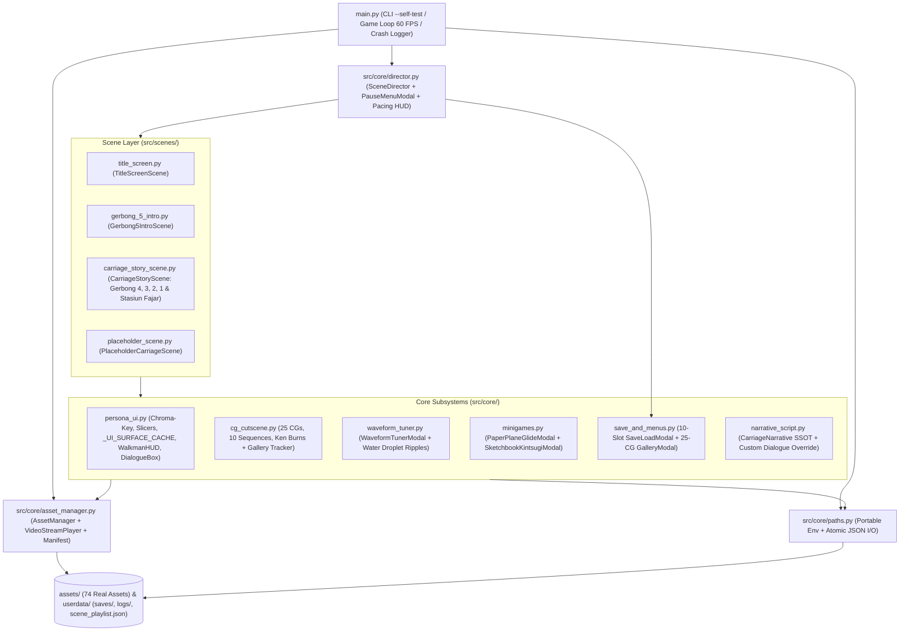
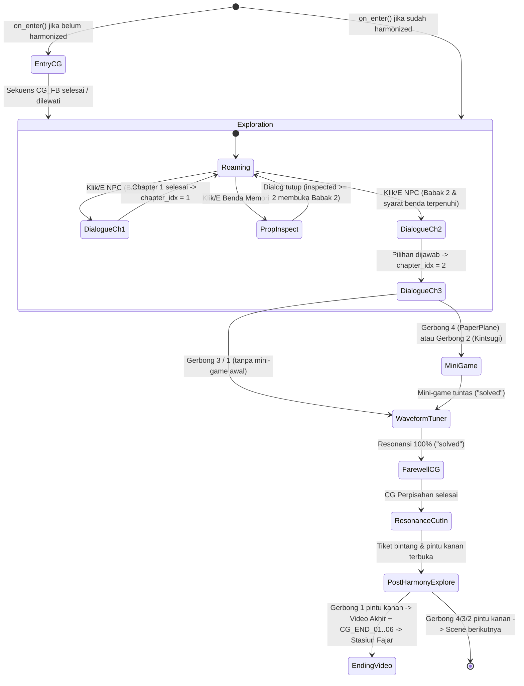

# System Requirements Document (SRD)
## Gerbong Terakhir ke Stasiun Senja (*Track 99: Resonance*)

---

## I. Metadata & Matriks Ketertelusuran (*Traceability Matrix*)

| Atribut Sistem | Spesifikasi Terkunci (*Locked*) |
| :--- | :--- |
| **Nama Sistem** | `GerbongTerakhir_StasiunSenja` (*Track 99: Resonance*) |
| **Pola Arsitektur** | *Modular Scene-Driven Desktop Game* (Standalone Offline Monolith, 60 FPS Fixed-Cap Loop) |
| **Bahasa & Engine Utama** | Python `3.10+` *(dibuat & diuji pada `3.12.0`)* + `pygame-ce` (SDL2) + `opencv-python` + `numpy` + `pillow` |
| **Resolusi Kanvas Tetap** | `1280 x 720` (*Windowed* default, dapat disesuaikan di `settings.json`) |
| **Mode Penyimpanan** | Portabel 100% di dalam direktori permainan (`./userdata/`), bebas kebocoran `%APPDATA%` / `%TEMP%` |

### Matriks Ketertelusuran (PRD $\rightarrow$ Layar UI $\rightarrow$ Modul & Kelas Teknis)

| ID PRD | Nama Fitur | Layar / Komponen UI | Modul & Simbol Kode Aktual (`src/`) |
| :--- | :--- | :--- | :--- |
| **`F-01`** | Menu Utama & Navigasi | `TitleScreenScene` | [title_screen.py](file:///d:/Farel/CV%20Masa%20Depan%20Gemilang/Project/Project%203/src/scenes/title_screen.py): `TitleScreenScene` |
| **`F-02`** | Efek WOW & Gerbong 5 | Gerbong 5 (*Sketch* $\rightarrow$ Warna + 7 Benda + Kondektur) | [gerbong_5_intro.py](file:///d:/Farel/CV%20Masa%20Depan%20Gemilang/Project/Project%203/src/scenes/gerbong_5_intro.py): `Gerbong5IntroScene`, `GERBONG_5_PROPS` |
| **`F-03`** | Pergerakan & NPC Non-Overlap | Seluruh Gerbong Gameplay + Kotak Dialog | [gerbong_5_intro.py](file:///d:/Farel/CV%20Masa%20Depan%20Gemilang/Project/Project%203/src/scenes/gerbong_5_intro.py), [carriage_story_scene.py](file:///d:/Farel/CV%20Masa%20Depan%20Gemilang/Project/Project%203/src/scenes/carriage_story_scene.py): `conductor_talk_x`, `npc_talk_x`, `PersonaDialogueBox` |
| **`F-04`** | Sistem Walkman 4 Kaset | `WalkmanHUD` & Filter Atmosfer/Video | [persona_ui.py](file:///d:/Farel/CV%20Masa%20Depan%20Gemilang/Project/Project%203/src/core/persona_ui.py): `CASSETTES`, `WalkmanHUD`, `resolve_cassette_video`, `render_cassette_atmosphere_filter` |
| **`F-05`** | Narasi 3 Babak & Eksplorasi Wajib | Dialog Bercabang & Papan Inspeksi Benda | [narrative_script.py](file:///d:/Farel/CV%20Masa%20Depan%20Gemilang/Project/Project%203/src/core/narrative_script.py): `CarriageNarrative`, `ChapterScript`, `PropScript`, `RAW_SCRIPTS` |
| **`F-06`** | Waveform Tuner & Efek Riak Air | `WaveformTunerModal` (Osiloskop + Pilihan Kaset) | [waveform_tuner.py](file:///d:/Farel/CV%20Masa%20Depan%20Gemilang/Project/Project%203/src/core/waveform_tuner.py): `WaveformTunerModal`, `trigger_ripple`, `compute_sync_ratio` |
| **`F-07`** | Mini-Game Pesawat Kertas & Kintsugi | Modal Mini-Game Gerbong 4 & Gerbong 2 | [minigames.py](file:///d:/Farel/CV%20Masa%20Depan%20Gemilang/Project/Project%203/src/core/minigames.py): `PaperPlaneGlideModal`, `SketchbookKintsugiModal` |
| **`F-08`** | Cutscene 25 CG & Galeri Kenangan | `WutheringWavesCGOverlay` & `CGGalleryModal` | [cg_cutscene.py](file:///d:/Farel/CV%20Masa%20Depan%20Gemilang/Project/Project%203/src/core/cg_cutscene.py): `ALL_CG_SLIDES`, `CG_SEQUENCES`, `WutheringWavesCGOverlay`; [save_and_menus.py](file:///d:/Farel/CV%20Masa%20Depan%20Gemilang/Project/Project%203/src/core/save_and_menus.py): `CGGalleryModal` |
| **`F-09`** | Cut-In Banner Penutup Bagian | Banner Senyum & Jempol Raka | [persona_ui.py](file:///d:/Farel/CV%20Masa%20Depan%20Gemilang/Project/Project%203/src/core/persona_ui.py): `AllOutResonanceBanner`; [carriage_story_scene.py](file:///d:/Farel/CV%20Masa%20Depan%20Gemilang/Project/Project%203/src/scenes/carriage_story_scene.py): `resonance_title` |
| **`F-10`** | Pause Menu & 10-Slot Save/Load | `PauseMenuModal` & `SaveLoadModal` | [save_and_menus.py](file:///d:/Farel/CV%20Masa%20Depan%20Gemilang/Project/Project%203/src/core/save_and_menus.py): `PauseMenuModal`, `SaveLoadModal`; [paths.py](file:///d:/Farel/CV%20Masa%20Depan%20Gemilang/Project/Project%203/src/core/paths.py): `write_json`, `load_save` |
| **`F-11`** | Bisikan Hujan & Refleksi Tertinggal | Siluet Refleksi Jendela (Kaset 2) | [carriage_story_scene.py](file:///d:/Farel/CV%20Masa%20Depan%20Gemilang/Project/Project%203/src/scenes/carriage_story_scene.py): `_pos_history`, `_render_window_reflection_lag` |
| **`F-12`** | Mode Penguji / Pacing Director HUD | Bilah Atas `F1`, Lompat Scene `[`/`]`, `F5` Hot-Reload | [director.py](file:///d:/Farel/CV%20Masa Depan%20Gemilang/Project/Project%203/src/core/director.py): `SceneDirector`, `DEFAULT_PLAYLIST`, `_render_director_bar` |

---

## II. Tech Stack Lock & Konfigurasi Lingkungan

### 2.1 Daftar Pustaka Inti (`requirements.txt`)

| Lapisan Sistem | Teknologi Terkunci | Peran & Alasan Penggunaan |
| :--- | :--- | :--- |
| **Runtime Bahasa** | Python `3.10+` *(dibuat & diuji pada `3.12.0` di `.venv` lokal)* | Kompatibel hingga Python `3.13`/`3.14` berkat paket *binary wheel* modern; diisolasi di `.venv/` agar konsisten antar laptop. |
| **Game Loop, Render & Audio** | `pygame-ce` (Community Edition, SDL2) | Memberikan *hardware-accelerated surface blitting*, pengelola *event loop* 60 FPS, `pygame.font`, dan `pygame.mixer` untuk BGM/SFX. |
| **Pemutar Video Latar** | `opencv-python` (`cv2.VideoCapture`) | Mendekode aliran video MP4 (`vid_01`–`vid_05`) secara *real-time* frame per frame ke *buffer* RGB untuk jendela kereta dan video cutscene. |
| **Pemrosesan Piksel & Audio** | `numpy` | Vektorisasi cepat untuk *chroma-key* jendela `#00FF00`, penghapusan latar magenta `#FF00FF` (*despill*), penarikan kontur *sprite sheet*, serta sintesis WAV SFX di `tools/generate_sfx_pack.py`. |
| **Pengolahan Gambar Pendukung** | `pillow` | Dukungan utilitas manipulasi gambar dan integrasi paket aset eksternal. |
| **Pemaket Portabel** | `pyinstaller` (`--onedir`) | Membungkus game beserta seluruh modul `src` dan pustaka `.venv` menjadi direktori portabel siap sebar tanpa kewajiban instalasi Python di komputer pemain. |

### 2.2 Arsitektur Lingkungan Portabel (*Zero-Leakage Path Isolation*)
Saat aplikasi dijalankan (baik lewat `main.py` maupun hasil *frozen* `.exe`), modul [paths.py](file:///d:/Farel/CV%20Masa%20Depan%20Gemilang/Project/Project%203/src/core/paths.py) memanggil `configure_portable_env()` **sebelum** mengimpor `pygame` atau `cv2`:
- `ROOT_DIR` diselesaikan otomatis ke folder `main.py` (mode Python) atau folder `sys.executable` (mode PyInstaller).
- Variabel lingkungan OS (`TEMP`, `TMP`, `TMPDIR`, `APPDATA`, `LOCALAPPDATA`, `XDG_CONFIG_HOME`, `XDG_DATA_HOME`, `XDG_CACHE_HOME`) dialihkan ke `./userdata/` dan `./userdata/temp/`.
- Jika dijalankan dari Python yang belum memiliki pustaka game, `ensure_local_venv()` akan memverifikasi ketersediaan `pygame`, `cv2`, `numpy`, dan `PIL`, lalu otomatis berpindah ke `.venv\Scripts\python.exe` lokal apabila valid (atau menampilkan panduan menjalankan `INSTALL_LIBRARIES.bat` jika folder berasal dari perangkat lain tanpa library terpasang).

---

## III. Arsitektur Sistem & Struktur Direktori

### 3.1 Diagram Arsitektur Berlapis



### 3.2 Pohon Direktori & Tanggung Jawab (*Single Source of Truth*)

```text
Project 3/
├── main.py                         # Titik masuk tunggal, parser --self-test, inisialisasi SDL, main loop 60 FPS
├── requirements.txt                # Kunci dependensi runtime (pygame-ce, opencv-python, numpy, pillow)
├── INSTALL_LIBRARIES.bat           # Script satu-klik pembuat .venv lokal & instalasi library aman tanpa .exe
├── RUN_GAME.bat                    # Launcher satu-klik (otomatis mendeteksi .venv/Python & instal jika belum ada)
├── README.md                       # Panduan instalasi & distribusi GitHub + Google Drive
├── .gitignore                      # Pengecualian .venv/, __pycache__/, file temp, dan build artifacts
├── Docs/                           # Seluruh dokumentasi produk, teknis, cerita, & prompt
│   ├── PRD.md
│   ├── SRD.md
│   ├── MATERI_PRESENTASI.md
│   ├── GAME_DESIGN_DOCUMENT.md
│   ├── story/                      # Dokumen desain cerita & novel
│   │   ├── STORY_BIBLE.md          # SSOT alur cerita, karakter, dan twist
│   │   └── NOVEL_TRACK99.md        # Naskah novel lengkap
│   └── prompts/                    # Arsip prompt aset visual, CG, & narasi
│       ├── DAFTAR_ASSET_DAN_PROMPT.md
│       ├── PROMPT_CG_NARASI.md
│       ├── PROMPT_ASET_TAMBAHAN.md
│       └── PROMPT_NARASI_MENDALAM.md
├── src/
│   ├── core/
│   │   ├── paths.py                # Resolusi root, isolasi env portabel, baca/tulis JSON atomik
│   │   ├── asset_manager.py        # Cache gambar/audio, VideoStreamPlayer OpenCV, fallback prosedural, audit
│   │   ├── director.py             # Manajemen playlist scene, transisi wipe diagonal, shortcut F1..F9 & [/]
│   │   ├── persona_ui.py           # Font, profil 4 kaset, chroma-key, auto-slicer, _UI_SURFACE_CACHE, HUD
│   │   ├── cg_cutscene.py          # Data 25 CG & 10 sekuens + WutheringWavesCGOverlay
│   │   ├── waveform_tuner.py       # Puzzle osiloskop frekuensi/amplitudo & animasi riak air
│   │   ├── minigames.py            # PaperPlaneGlideModal (G4) & SketchbookKintsugiModal (G2)
│   │   ├── save_and_menus.py       # SaveLoadModal (10 slot), CGGalleryModal (25 CG), PauseMenuModal
│   │   └── narrative_script.py     # SSOT dialog seluruh gerbong & loader userdata/custom_dialogues.json
│   └── scenes/
│       ├── title_screen.py         # Main menu Raka duduk & sunset video
│       ├── gerbong_5_intro.py      # Prolog, efek WOW shockwave warna, 7 benda, Pak Kondektur
│       ├── carriage_story_scene.py # Engine data-driven bersama untuk Gerbong 4, 3, 2, 1 & Stasiun Fajar
│       └── placeholder_scene.py    # Template prototipe gerbong ringan
├── tools/
│   ├── generate_sfx_pack.py        # Generator 10 efek suara WAV akustik 44.1kHz stereo via NumPy
│   └── build_portable.py           # Auditor aset (--audit / --archive-unused) & builder PyInstaller (--build)
├── assets/                         # Total 74 aset terverifikasi:
│   ├── audio/bgm/                  # 7 berkas MP3 (bgm_00 .. bgm_06)
│   ├── audio/sfx/                  # 10 berkas WAV akustik
│   ├── images/backgrounds/         # 8 latar gerbong & Stasiun Fajar
│   ├── images/cg/                  # 25 ilustrasi CG
│   ├── images/portraits/           # 3 sheet potret & cut-in banner
│   ├── images/sprites/             # 15 sprite sheet karakter, pose duduk & benda
│   ├── images/ui/                  # 1 aset UI Walkman & kaset fisik
│   └── videos/                     # 5 video MP4 (vid_01 .. vid_05)
└── userdata/
    ├── scene_playlist.json         # Urutan playlist & budget durasi 45 menit per scene
    ├── logs/
    │   ├── used_assets_manifest.json # Daftar aset aktif yang diakses saat runtime
    │   └── last_crash.txt          # Jejak traceback bila terjadi eksepsi tak tertangani
    ├── temp/                       # Ruang kerja sementara library pihak ketiga
    └── saves/
        ├── settings.json           # Pengaturan resolusi, volume, dan toggle debug/visual
        ├── slot_1.json..slot_10.json # 10 slot simpanan progres pemain
        └── gallery_unlocked.json   # Daftar CG yang terbuka lintas permainan
```

---

## IV. Desain Penyimpanan Data & Skema JSON

Seluruh penyimpanan memakai format JSON UTF-8 melalui fungsi `write_json()` di `src/core/paths.py` dengan mekanisme **penulisan atomik** (`menulis ke *.json.tmp` lalu `tmp_path.replace(path)`), sehingga tidak akan membuat berkas korup jika proses terhenti mendadak.

### 4.1 Skema Konfigurasi (`userdata/saves/settings.json`)
```json
{
  "resolution": [1280, 720],
  "fullscreen": false,
  "bgm_volume": 0.75,
  "sfx_volume": 0.85,
  "show_director_hud": false,
  "persona_cutin_fx": true,
  "slow_cozy_sway": true
}
```

### 4.2 Skema Slot Penyimpanan (`userdata/saves/slot_1.json` .. `slot_10.json`)
| Field | Tipe | Keterangan / Aturan |
| :--- | :--- | :--- |
| `slot` | `string` | Pengenal slot (`"slot_1"` s/d `"slot_10"`). |
| `current_scene` / `resume_scene` | `string` | ID scene target saat *load game* (otomatis mencegah `"title_screen"` sebagai target *resume* agar langsung masuk gerbong terakhir). |
| `carriage_title` | `string` | Label terbaca manusia dari `SCENE_LABELS` (misal `"Gerbong 3 — Nadia & Waktu"`). |
| `saved_at` | `string` | Stempel waktu lokal berformat `"%d %b %Y, %H:%M"`. |
| `collected_cassettes` / `cassette_unlocked` | `list[int]` | Daftar ID kaset terbuka `[1..4]`; kaset `1` selalu dinormalisasi terbuka. |
| `active_cassette` | `int` | ID kaset yang sedang diputar (`0` = Keheningan, `1`..`4`). |
| `elapsed_total_seconds` | `float` | Total waktu bermain dalam detik yang dipantau terhadap target 45 menit. |
| `harmonized_carriages` | `list[str]` | ID gerbong yang sudah selesai *Waveform Tuner* & meninggalkan potongan tiket bintang. |
| `inspected_props` | `list[str]` | Daftar kunci unik berformat `"<scene_id>:<prop_key>"` untuk validasi syarat eksplorasi Babak 2. |
| `completed_minigames` | `list[str]` | ID gerbong yang mini-game spesifiknya (*paper plane* / *kintsugi*) telah tuntas. |
| `seen_cg` | `list[str]` | Daftar ID sekuens/CG yang sudah diputar agar kilas balik tidak terulang secara otomatis. |
| `ticket_stubs` | `int` | Jumlah potongan tiket berbintang (`0..4`). |
| `ending_reached` | `bool` | Penanda bahwa *ending* Peron Stasiun Fajar telah dicapai. |
| `g5_door_unlocked` | `bool` | Status terbukanya pintu kanan Gerbong 5 setelah dialog Kondektur. |

### 4.3 Skema Galeri Global (`userdata/saves/gallery_unlocked.json`)
```json
{
  "unlocked": [
    "cg_00a_wakeup_window",
    "cg_bima_a_paper_plane_window",
    "cg_end_01_grandpa_conductor"
  ]
}
```
Setiap ID CG pada `ALL_CG_SLIDES` (`25` entri) otomatis ditambahkan ke berkas ini melalui `unlock_cg_in_gallery()` tepat saat slide ditampilkan di `WutheringWavesCGOverlay`, atau dibuka seluruhnya lewat tombol pratinjau / tombol `F8` di Galeri.

---

## V. Spesifikasi Modul Inti, Algoritma, & State Machine

### 5.1 State Machine Alur Interaksi di Dalam Gerbong (`CarriageStoryScene`)



### 5.2 Spesifikasi Algoritma Utama

#### A. *Chroma-Key* Jendela `#00FF00`, Pemotongan Sprite `#FF00FF`, & Cache Surface (`persona_ui.py`)
1. **Masking Jendela Video (`_key_green_window_surface`):** Gambar latar gerbong diubah ke array NumPy `int16`. Piksel diklasifikasikan sebagai kaca jendela hijau jika memenuhi `(g > 150) & ((g - np.maximum(r, b)) > 42)`. Piksel tersebut diberi `alpha = 20` (semi-transparan untuk pantulan halus), lalu tepian *fringe* hijau (`(g - np.maximum(r, b)) > 20`) dinetralkan warnanya (*green despill*) sebelum dimodulasi oleh `tint_rgb` milik kaset aktif. Di bawah layer inilah frame video MP4 dari `VideoStreamPlayer` di-*blit*.
2. **Pemotongan Sprite Sheet Otomatis (`_remove_magenta_surf`, `_slice_row_sprites`, `_slice_2x2_prop_sheet`):** Piksel latar magenta dideteksi dengan `excess = np.minimum(r, b) - g`, mask `bg_mask = (r > 155) & (b > 155) & (excess > 45)` diset ke `alpha = 0`, lengkap dengan penghalusan halo JPEG pada tepian sprite. Pemotongan frame memakai deteksi rentang piksel aktif horizontal (`_find_1d_spans`) agar tetap menjaga proporsi tinggi antar-karakter (mis. Raka `310px`, Nadia `296px`, Senja `294px`, Bima `225px`, Raka Kecil `220px`, Kondektur `312px`).
3. **Cache Permukaan (`_UI_SURFACE_CACHE`):** Seluruh hasil operasi NumPy (latar gerbong, pose duduk, sprite 4-frame, potret, dan ikon benda) disimpan dalam `_UI_SURFACE_CACHE`. Hal ini memangkas jeda pemuatan ~1 detik saat berpindah gerbong atau mengganti kaset, dan hanya dikosongkan lewat `clear_ui_caches()` saat `F5` (*Hot-Reload*) ditekan.

#### B. *Illustrated CG Cutscene Engine* (`cg_cutscene.py`)
- Menggunakan `WutheringWavesCGOverlay` yang mengelola 4 fase: `"fade_in"`, `"playing"`, `"crossfade"`, dan `"fade_out"`.
- Efek gerak halus (*Ken Burns zoom*) dihitung dengan *zoom step* terkuantisasi di `_zoom_cache` agar penskalaan gambar `1280x720` tidak membebani CPU di setiap frame.
- Sekuens kilas balik (`cg_seq_fb1`..`fb4`) memakai tirai hitam `(8, 8, 12)` dan `shake_on_enter = True`, sedangkan perpisahan dan *ending* memakai tirai putih hangat `(248, 246, 240)`.

#### C. *Waveform Tuner* & Efek Riak Tetesan Air (`waveform_tuner.py`)
- **Persamaan Gelombang:** Untuk setiap posisi ternormalisasi $f \in [0, 1]$ di osiloskop:
  $$y_{\text{target}}(f, t) = y_c + A_{\text{target}} \cdot \sin(2\pi f \cdot \omega_{\text{target}} - 3t)$$
  $$y_{\text{player}}(f, t) = y_c + A_{\text{player}} \cdot \sin(2\pi f \cdot \omega_{\text{player}} - 3t) + \Delta y_{\text{ripple}}(f, t)$$
- **Kalkulasi Sinkronisasi (`compute_sync_ratio`):**
  $$\text{score}_{\text{freq}} = \max\left(0, 1 - \frac{|\omega_p - \omega_t|}{2.2}\right), \quad \text{score}_{\text{amp}} = \max\left(0, 1 - \frac{|A_p - A_t|}{48.0}\right)$$
  Jika kaset tepat (`current_cassette == required_cassette`) dan `sync >= 0.88`, maka `resonance_gauge` meningkat `1.15 * dt` per detik hingga mencapai `1.0` (~`0.87` detik tahan stabil) dan mengembalikan `"solved"`.
- **Efek Riak Tetesan Air (`trigger_ripple` & `_render_ripples`):** Setiap pergantian kaset di dalam Tuner memunculkan 3 cincin elips/lingkaran konsentris yang memuai dari tombol kaset & pusat osiloskop, 8 percikan titik memancar radial, serta gangguan gelombang teredam eksponensial:
  $$\Delta y_{\text{ripple}} = \sin(30 |f - 0.5| - 16t) \cdot e^{-4.5 |f - 0.5|} \cdot 16.0 \cdot \text{wave\_disturb\_t}$$

#### D. *Auto-Walk* & Interaksi NPC Bebas Tumpang-Tindih (`gerbong_5_intro.py` & `carriage_story_scene.py`)
- Ketika pemain menekan `[E]` di sekitar NPC atau mengklik *hitbox* NPC dengan mouse, target jalan tidak diarahkan ke koordinat tengah NPC, melainkan ke posisi berdiri berjarak aman (`conductor_talk_x = self.conductor_x - 120.0` yaitu `915.0` di Gerbong 5; `npc_talk_x = self.npc_x - 125.0` yaitu `730.0` di Gerbong 4–1).
- Tepat sebelum kotak dialog dibuka, `facing_right` diset `True` sehingga Raka dan NPC saling berhadapan dengan ruang visual bersih. Saat `dialogue.visible == True`, masukan gerak A/D/Panah diblokir agar pemain tidak bisa berjalan menembus saat berbicara.

#### E. Efek Refleksi Kaca Tertinggal (`_render_window_reflection_lag`)
- Selama eksplorasi, koordinat pemain tiap frame disimpan dalam *bounded deque* `_pos_history(maxlen=90)`.
- Ketika `cassette_id == 2` (*HUJAN*), sistem mencari posisi historis pada `self.t - 0.28` detik sebelumnya dan merendernya di belakang layer kaca dengan modulasi biru redup `(110, 170, 235, 65)` sebagai *visual foreshadowing* tersembunyi.

---

## VI. Penanganan Edge Cases & Ketahanan Sistem (*Resilience*)

| Skenario Gangguan / Edge Case | Penanganan di Level Kode |
| :--- | :--- |
| **Perangkat tanpa audio / driver headless** | `main.py` membungkus `pygame.mixer.init()` dengan `try..except pygame.error` dan `--self-test` menyetel `SDL_VIDEODRIVER=dummy` & `SDL_AUDIODRIVER=dummy`. |
| **Aset gambar/video tidak ditemukan saat iterasi** | `AssetManager` mencatat ke `fallback_assets` dan menyintesis piksel-art prosedural (*sketch*, *sunset*, *rain*, *courage*, *dawn*) agar game tidak pernah *crash*. |
| **Karakter Unicode kotak (*tofu*) pada font sistem Windows** | Simbol segitiga *play*, garis menu *hamburger*, dan ikon panah dirender langsung memakai primitif vektor `pygame.draw.polygon` / `pygame.draw.line` (bukan karakter glyph font langka). |
| **Kegagalan `importlib.import_module` setelah dibundel PyInstaller** | Seluruh modul scene diimpor secara eksplisit statis di `main.py` baris 19–24 dan dikunci via `--collect-submodules src` serta `--hidden-import` di `tools/build_portable.py`. |
| **Kagagalan penulisan Save File di tengah proses** | `paths.write_json()` menulis ke berkas sementara `.tmp` terlebih dahulu sebelum menimpa berkas utama secara atomik (`tmp_path.replace(path)`). |
| **Koma/spasi font terlalu sempit & teks keluar panel** | `PersonaDialogueBox` melakukan pembungkusan kata (*word wrap*) terhadap kalimat penuh saat `set_dialogue()` dipanggil sebelum efek *typewriter* berjalan per indeks karakter, mencegah kata melompat baris di tengah ketikan. |

---

## VII. Kebutuhan Non-Fungsional (NFR), Self-Test, & Pipeline Build

1. **Performa & Frame Rate:** Target *frame rate* dikunci di `60 FPS` (`dt = min(0.05, clock.tick(60) / 1000.0)` di `main.py`) agar pergerakan karakter dan animasi ombak/riak tetap deterministik meski *frame time* berfluktuasi.
2. **Verifikasi Otomatis (`--self-test`):**
   ```powershell
   .\.venv\Scripts\python.exe main.py --self-test
   ```
   Menguji *TitleScreen*, Modal *Load/Gallery*, pemutaran seluruh `25` CG, `10` sekuens, `10` WAV SFX, *round-trip* penulisan & pembacaan `slot_10.json` (lalu memulihkan status awal), serta memverifikasi nol aset hilang (`missing_fallback_assets: []`).
3. **Audit & Pembersihan Aset (`tools/build_portable.py`):**
   ```powershell
   .\.venv\Scripts\python.exe tools/build_portable.py --audit
   ```
   Mencocokkan seluruh berkas di `assets/` terhadap `userdata/logs/used_assets_manifest.json` (`74` aset aktif terpakai, `0` aset menganggur, `0` aset *draft*).
4. **Pembungkusan Rilis Portabel:**
   ```powershell
   .\.venv\Scripts\python.exe tools/build_portable.py --build
   ```
   Menghasilkan `dist/GerbongTerakhir_StasiunSenja/` beserta arsip `.zip` siap sebar (hanya menyalin aset aktif yang tercatat di manifes).
